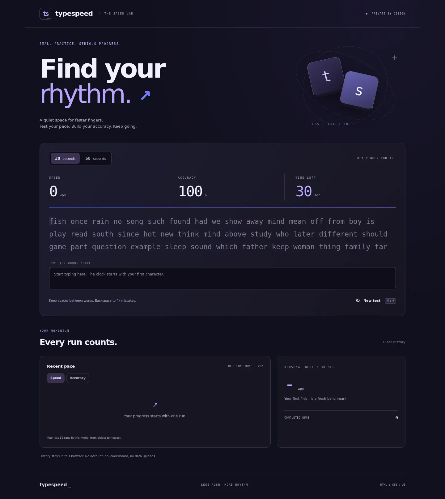
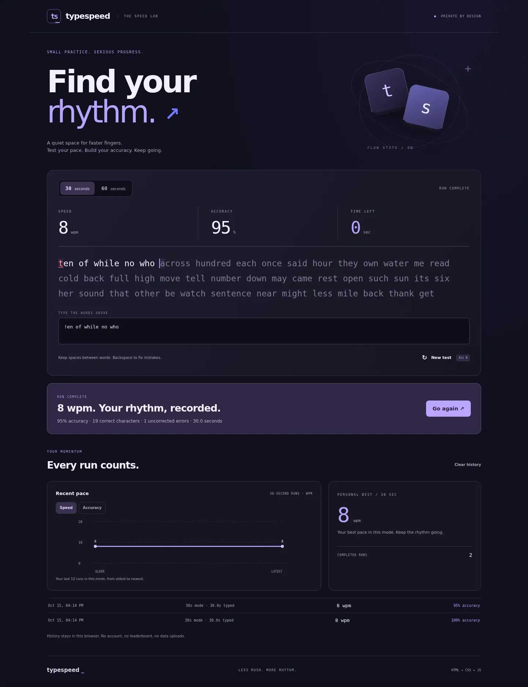
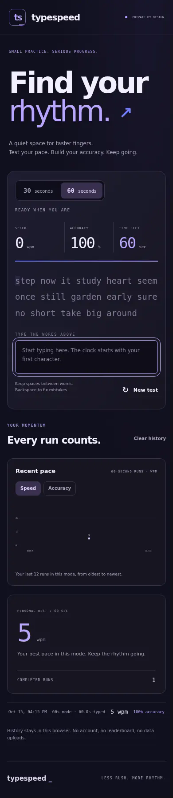

# TypeSpeed
### Less rush. More rhythm.

A focused typing speed test with a violet-and-cobalt speed-lab theme, oversized type, live metrics and a private progress log. No sign-in, backend, framework or build step.



## Features
- Random prompts drawn from a built-in bank of common English words.
- 30-second and 60-second modes. The clock starts with your first character.
- Live correct-character WPM and accuracy, with a character-by-character prompt highlight.
- Backspace to correct mistakes. Paste and drag-drop are disabled in the typing field.
- Timer based on elapsed monotonic time, not the number of interval ticks. Switching tabs does not pause a test.
- Result summary, personal best per mode, last 12 runs in a switchable speed/accuracy SVG graph and last five results as text.
- Up to 50 results stored in this browser. Clear history asks first.
- Responsive layout, visible keyboard focus, reduced-motion support and a labeled SVG chart.

## Run it
Open `index.html` in a current browser, or serve the folder with any static server. There are no runtime dependencies.

1. Pick 30 or 60 seconds.
2. Type the displayed words into the input below them, including spaces.
3. The test ends when time runs out or the entire prompt is entered.
4. Select **Go again** or **New test** for fresh words. **Alt + R** also starts a new test. Restarting abandons the unfinished run without saving it.
5. Switch duration to view that mode's own history and personal best.

## How the numbers work
A "word" is the standard five characters, including spaces.

- **WPM** = correctly matched characters / 5 / elapsed minutes, rounded to the nearest integer.
- **Accuracy** = correctly matched characters / characters currently entered × 100.
- Backspaced mistakes no longer count as errors. This is final-text accuracy, not lifetime keystroke accuracy.
- For the first live second, the WPM denominator is held at one second to avoid a huge startup spike. Final results use actual elapsed time.
- A complete timed test uses 30 or 60 seconds. If you enter the whole prompt early, the result uses its actual shorter duration and shows it in the history.

This is a personal practice tool, not a proctored or anti-cheat benchmark. Browser text input can be automated; there is no public leaderboard.

## Screenshots
These are actual browser captures. The SVG files contain compressed raster screenshot pixels, not recreated layouts. Result values below were produced by automated QA, not a real person's claimed typing performance. New installations start with no history.





## Tests
With Node.js:

```sh
node core.test.cjs
```

Thirteen dependency-free assertions cover deterministic prompt generation, WPM and accuracy, zero elapsed time, input length bounds, timer boundaries, invalid stored data and the 50-result limit.

Browser QA verified full 30/60-second timing with a controlled clock, exact WPM/accuracy values, mode locking during a run, new random prompts on restart, graph points, persistence after reload, history clearing, and zero horizontal overflow at 320px and 390px. No uncaught JavaScript errors were found.

## Privacy
History is stored under `typespeed.v1` in local storage. It is not uploaded or synced, and clearing browser/site data removes it. Storage failures show a warning. Typed text is not saved in the history. There are no trackers, external fonts, network calls or third-party scripts in the app.

## Source map
- `index.html`: semantic page and controls
- `style.css`: responsive violet/cobalt theme
- `core.js`: pure metrics, timer, prompt and validation helpers
- `app.js`: test state machine, DOM updates, local history and SVG chart
- `core.test.cjs`: Node helper assertions
- `desktop.svg`, `mobile.svg`, `results.svg`: actual browser screenshots
